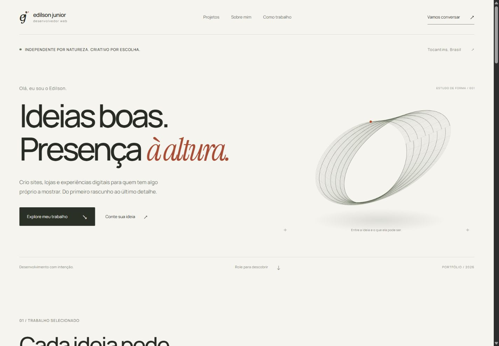

# Edilson Junior — Portfólio

Portfólio pessoal de desenvolvimento web, com projetos para negócios, experiências interativas e contato direto.

Projeto estático pronto para executar localmente ou hospedar.



## Projetos selecionados

- **Bola da Vez 10:** loja virtual de equipamentos esportivos.
- **Aires Films:** site de produtora audiovisual.
- **A Terra que Rejeitou:** jogo de plataforma inspirado nos biomas e no folclore brasileiros.
- **ENEM Quest:** aplicativo de estudos com gamificação e sessões de foco.
- **Clínica Integra:** template demonstrativo com agendamento e painéis para a equipe.

## Recursos

- Layout responsivo para computador e celular.
- Filtros e apresentação dos detalhes de cada projeto.
- Contato pelo WhatsApp com mensagem conforme o tipo de projeto.
- Fita vetorial que reage suavemente ao ponteiro.
- Navegação por teclado, foco visível e preferência por movimento reduzido.
- Fontes locais, sem dependências de build na página principal.

## Executar localmente

Com Python instalado, execute na pasta do projeto:

```bash
python -m http.server 4179
```

Abra `http://localhost:4179`. O servidor permite carregar os módulos da demonstração da clínica.

## Estrutura

```text
index.html       Conteúdo e estrutura da página
styles.css       Identidade visual e layout responsivo
app.js           Filtros, detalhes, contato e interação vetorial
fonts.css        Fontes locais
assets/          Imagens, fontes e licenças
demos/clinica/   Demonstração da Clínica Integra
```

## Demonstração da clínica

A Clínica Integra é um template com clínica, pacientes e acessos fictícios. Os dados são armazenados somente no navegador. Os perfis são simulados, sem autenticação real ou backend; não utilize dados reais de pacientes.

## Créditos

As imagens dos projetos fazem parte do material do portfólio. As capas de A Terra que Rejeitou e ENEM Quest são composições editoriais em HTML/SVG. Manrope e Instrument Serif seguem as licenças incluídas em `assets/`. A demonstração da clínica mantém o crédito de sua fotografia ilustrativa.

Desenvolvido para **Edilson Junior** · [GitHub](https://github.com/popiecloblestone).
